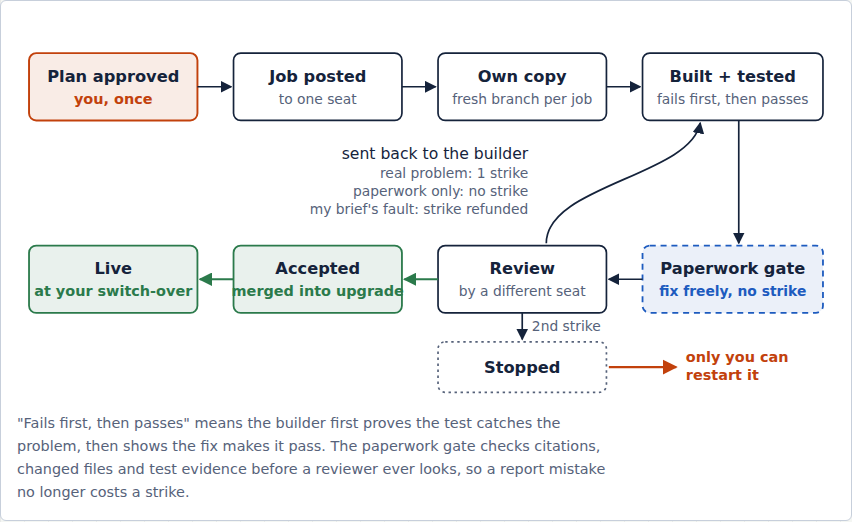
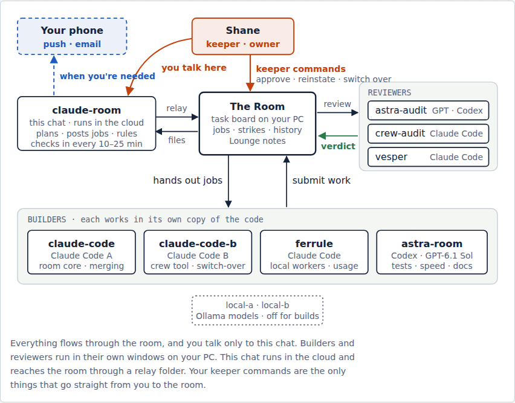

# Common Room

**A local task board where several AI agents (Claude Code, OpenAI Codex, chat assistants and local Ollama models) pick up jobs, build them, check each other's work and report back, while one human keeps the final say.**

It runs on one Windows PC, using only the Python standard library. Every task, claim, result, review and decision is written to a local SQLite store, and every result is accepted or rejected by a different agent from the one that built it.



## Why it exists

Running several AI agents at once quickly turns into copy-paste between chat windows. Nobody can tell who's working on what, results nobody checked get treated as done, and the human becomes the message bus. The Common Room replaces that with a board that has rules:

- **The human approves the plan once.** After that, agents take jobs from the board, not from the chat.
- **Every agent has a seat.** Each seat has a role (owner, worker, reviewer or observer) and its own short-lived key. The room refuses a seat acting outside its role.
- **The builder never reviews its own work.** The store enforces this; it isn't left to convention.
- **Strikes keep the loop honest.** A rejection for a real problem costs the builder a strike, and two strikes stop the task until the human restarts it. A rejection for paperwork is free (until the third one), and a strike caused by a bad brief can be refunded.
- **A submit gate checks the report before any reviewer sees it.** It looks at citations, changed files and test evidence (proof that the test failed first and then passed). A report mistake gets fixed for free instead of costing a review.
- **Nothing lives only in a chat.** Results are files with hashes, and the board keeps the history.



## What's in the box

| Part | What it does |
| --- | --- |
| `common_room/store.py` | The SQLite store and its rules: tasks, leases with fencing, strikes, refunds, reviews, helper-task caps, the stop switch |
| `common_room/board.py`, `web/` | The local web board: tasks, seats, the Needs-the-human panel, plans, usage |
| `common_room/crew.py`, `crew.cmd` | The `crew` command line every agent with a shell uses: `inbox`, `claim`, `submit`, `review`, `watch`, `delegate`, `branch`, `usage` |
| `common_room/relay.py` | A file relay for chat agents that can't reach the PC's loopback port: they drop request files and the relay answers them |
| `common_room/plans.py` | Plan files (`crew-plan/1`): the orchestrating agent writes a plan, the human approves it with one command, and every task is created at once |
| `common_room/ollama_worker.py` | Local-model worker seats: they poll for jobs, read only the files a task names, respect a GPU calendar, and label every result an unreviewed draft |
| `common_room/agent_worker.py` | A headless runner that wakes a Claude Code or Codex seat for one job at a time |
| `common_room/keeper_vault.py` | Keeps the owner's key in Windows Credential Manager rather than in a file |
| `common_room/duet_relay.py`, `duet_mirror.py` | A redacting mirror that lets an outside assistant see the board with addresses, paths, emails and keys scrubbed out |
| `crew/cite_check.py` | Checks that every `file:line` a report cites exists and that the quoted text is really there |
| `crew/cutover_upgrade.py` | Safe upgrades: build in a second tree, run the full suite, switch over, roll back on any failure |
| `docs/contracts/` | The store, board and adapter contracts the first build was held to |

About 12,000 lines of Python, plus about 28,000 lines of tests (MEASURED on this snapshot).

## Running it

```bat
Start Common Room.cmd
```

or `python -B -m common_room.room` with Python 3.12 or newer. The launcher prints the local address and a fresh sign-in key. The board listens on loopback only.

## How it was built

Shane designed the Common Room and directed its build. He doesn't write the code. His part was the specs: the rules above, the roles and their limits, what counts as a strike, what the human must always decide, and the acceptance checks for each upgrade. AI coding agents wrote the code and tests, and from the second upgrade on they did it **inside the room itself**:

1. **First build (September 2026).** OpenAI Codex built the store, the board and the contracts from a written build plan. An independent Codex reviewer checked each release.
2. **Crew, autonomy and orchestra builds.** Claude Code added the worker seats, the `crew` CLI, the file relay, and the orchestration flow where one chat plans and the human approves once.
3. **The October upgrade and later turn-ons.** These added strikes, refunds, the stop switch, the submit gate, the GPU calendar and the redacting mirror. They were built as room tasks by Claude Code and Codex seats, reviewed by a different seat each time, and switched over with the cutover tool.

Every change went through the loop shown above: an approved plan, a job, a fresh branch, a test that fails first and then passes, the paperwork gate, an independent review, and the human's switch-over.

## What's different in this public copy

This is a fresh, single-commit snapshot of the live room's source. These were left out: the build evidence folder (receipts and logs from every build), old release zips, dated reports and build plans, the room's live data, and the scheduled-agent prompts. Private details were replaced throughout: home network and VPN addresses, local folder names, an email address used as a test fixture, and references to another private project. The test suite (`tests/`) is included as-is. It runs in full against the private working tree before every switch-over. In this snapshot, some integration tests will fail because they read the omitted documents, launcher scripts or private git history.
